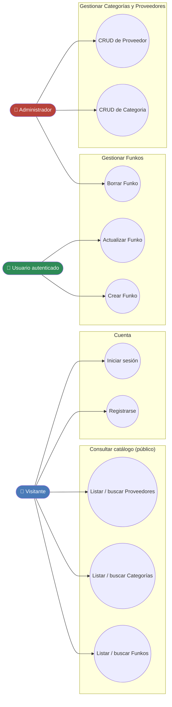
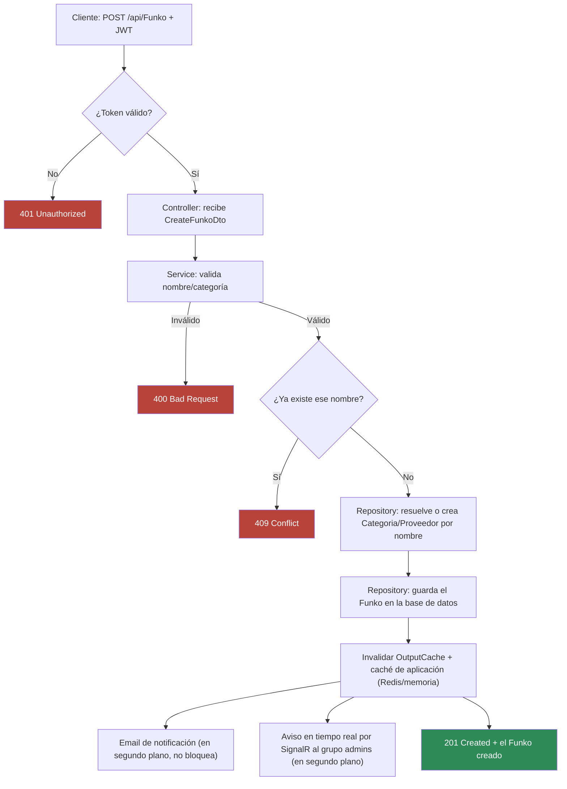
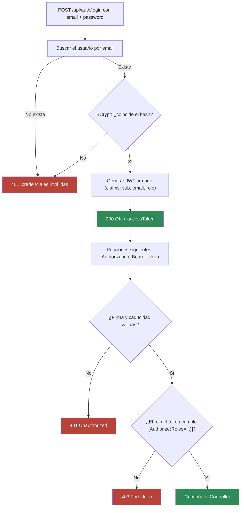
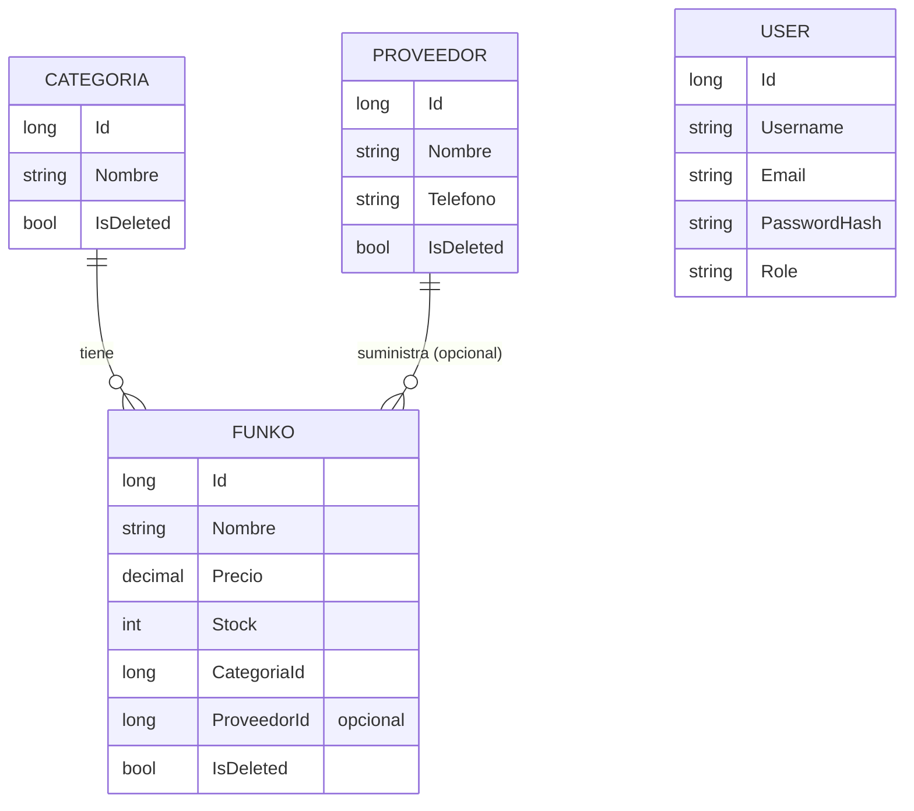

# Casos de uso y diagramas — FunkoApp

Este documento explica **qué hace la aplicación y para quién**, de principio a fin, antes
de entrar en el código. Los diagramas están en `Mermaid` — el mismo lenguaje de diagramas
que usa José Luis en todo su material (206 diagramas en sus apuntes: flowcharts, secuencia,
entidad-relación), así que se renderizan igual en GitHub sin necesidad de ninguna
herramienta externa.

Analogía de partida, la misma que en la exposición: FunkoApp es como una **cafetería**.
Hay un mostrador (la API), un cliente que pide (quien llama a la API), un barista que
prepara el pedido siguiendo las normas de la casa (el Service) y un almacén de donde se
sacan los ingredientes (la base de datos). Los diagramas de abajo son, literalmente, el
plano de esa cafetería: quién puede pedir qué, y qué pasa en la cocina cuando se pide algo.

---

## 1. Actores

| Actor | Quién es | Analogía |
|---|---|---|
| **Visitante** | Cualquiera, sin iniciar sesión | Alguien que mira el escaparate |
| **Usuario autenticado** | Ha iniciado sesión (`POST /api/auth/login`) | Un cliente habitual con cuenta |
| **Administrador** | Usuario autenticado con rol `ADMIN` | El encargado de la cafetería |

Cada actor incluye los permisos de los anteriores: un Administrador puede hacer todo lo
que puede hacer un Usuario autenticado, y este todo lo que puede un Visitante.

---

## 2. Diagrama de casos de uso



### Tabla de trazabilidad (caso de uso → endpoint real)

| Caso de uso | REST | GraphQL |
|---|---|---|
| Listar/buscar Funkos | `GET /api/Funko`, `/search`, `/paged` | `{ funkos }`, `{ funko(id) }` |
| Listar/buscar Categorías | `GET /api/Categoria`, `/search`, `/paged` | `{ categorias }` |
| Listar/buscar Proveedores | `GET /api/Proveedor`, `/search`, `/paged` | — |
| Registrarse | `POST /api/auth/signup` | — |
| Iniciar sesión | `POST /api/auth/login` | — |
| Crear Funko | `POST /api/Funko` | `mutation { crearFunko }` |
| Actualizar Funko | `PUT`/`PATCH /api/Funko/{id}` | `mutation { actualizarFunko }` |
| Borrar Funko (solo Admin) | `DELETE /api/Funko/{id}` | `mutation { eliminarFunko }` |
| CRUD Categoria (solo Admin para escribir) | `POST`/`PUT`/`DELETE /api/Categoria` | — |
| CRUD Proveedor (solo Admin para escribir) | `POST`/`PUT`/`DELETE /api/Proveedor` | — |

---

## 3. Diagrama de flujo — Crear un Funko (el caso de uso central)

Es el flujo que toca más piezas del sistema a la vez: autenticación, validación, caché
(dos capas), notificaciones por email y en tiempo real.



---

## 4. Diagrama de flujo — Iniciar sesión y usar el token



---

## 5. Diagrama de secuencia — Arquitectura en capas (cualquier petición)

Este es el que de verdad explica "cómo está organizado por dentro": la misma cadena para
Funko, Categoria y Proveedor.

```mermaid
sequenceDiagram
    actor Cliente
    participant Controller
    participant Service
    participant Validator
    participant Cache as ICacheService
    participant Repository
    participant DB as Base de datos

    Cliente->>Controller: HTTP request (DTO)
    Controller->>Service: método del servicio
    Service->>Validator: valida reglas de negocio
    Validator-->>Service: Result OK / errores

    alt lectura
        Service->>Cache: GetOrSetAsync(clave)
        Cache->>Repository: (si hay MISS) consulta real
        Repository->>DB: SELECT
        DB-->>Repository: filas
        Repository-->>Cache: Modelo de dominio
        Cache-->>Service: valor (cacheado o fresco)
    else escritura
        Service->>Repository: Add/Update/SoftDelete
        Repository->>DB: INSERT/UPDATE
        DB-->>Repository: entidad guardada
        Repository-->>Service: Modelo de dominio
        Service->>Cache: invalida claves afectadas
    end

    Service-->>Controller: Result&lt;Dto, DomainError&gt;
    Controller-->>Cliente: código HTTP + cuerpo
```

---

## 6. Diagrama entidad-relación



> `USER` aparece sin ninguna línea de relación a propósito: no existe ninguna relación
> real entre un usuario y un Funko en el modelo (quién creó un Funko no se guarda). Se
> incluye en el diagrama solo porque es una tabla real de la base de datos.

---

## 7. Por qué estos diagramas y no otros

José Luis no usa diagramas de casos de uso UML en su material (se comprobó antes de
añadir nada: "caso de uso" aparece en su texto como expresión genérica, nunca como un
diagrama). Sí usa Mermaid de forma masiva para flowcharts, diagramas de secuencia y de
entidad-relación — así que estos tres sí siguen su estilo exacto. El diagrama de casos de
uso es la única pieza añadida desde fuera (de la asignatura de Entornos de Desarrollo),
declarado aquí explícitamente como tal, igual que pide la regla de oro del proyecto.
